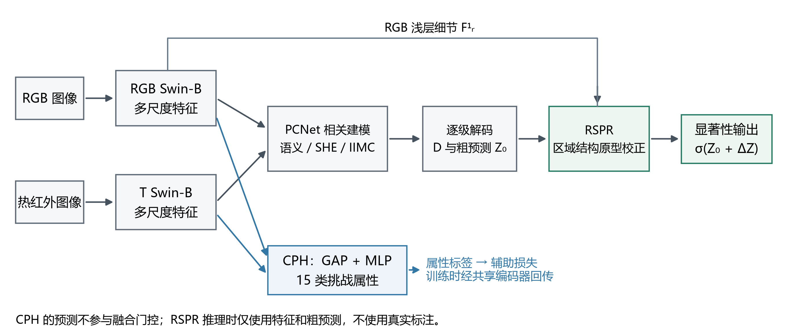
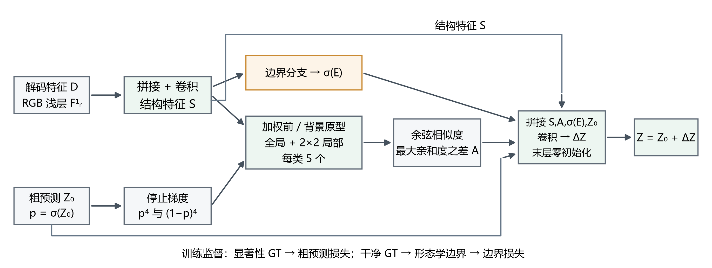

# PCNet + CPH + RSPR：未对齐 RGB-T 显著性目标检测

本项目基于 [PCNet](https://github.com/Angknpng/PCNet) 的公开实现，研究挑战属性辅助监督与区域结构原型校正对未对齐 RGB-T 显著性目标检测的作用。项目包含共同基线、两个新增模块、四组训练入口，以及三个随机种子的实验配置、训练历史和指标数据。

对应研究题目：**融合挑战属性监督与区域结构原型校正的未对齐 RGB-T 显著性目标检测**。

## 方法概览

- **CPH（挑战属性辅助预测头）**：对双模态深层特征做全局池化，使用训练集已有的15类挑战属性进行辅助多标签训练，通过共享编码器影响显著性特征学习。属性概率不作为融合门控，推理无需属性标签。
- **RSPR（区域结构原型校正）**：融合解码特征与RGB浅层细节，按粗预测构造全局及局部前景、背景原型，结合亲和度和预测边界生成残差，校正粗显著性输出。推理无需真实掩码。

| 训练入口 | CPH | RSPR |
| --- | --- | --- |
| train_pcnet.py | 关闭 | 关闭 |
| train_cph.py | 开启 | 关闭 |
| train_rspr.py | 关闭 | 开启 |
| train_cph_rspr.py | 开启 | 开启 |

四组共用同一PCNet基础实现。各次训练从相同的Swin-B与IHN预训练组件初始化，不加载训练完成的PCNet权重。

## 主要结果

### UVT20K消融

以下为**固定第80轮 final.pth 的离线结果**，报告三个种子的均值与样本标准差（种子：42、2026、4536）。本地PCNet为共同实验基线。

| 配置 | MAE ↓ | Sm ↑ | 加权F ↑ |
| --- | --- | --- | --- |
| PCNet（本地） | 0.04143 ± 0.00389 | 0.86203 ± 0.01683 | 0.76107 ± 0.05980 |
| + CPH | 0.03850 ± 0.00200 | 0.87800 ± 0.00559 | 0.81707 ± 0.01080 |
| + RSPR | 0.03880 ± 0.00210 | 0.87217 ± 0.01272 | 0.79607 ± 0.04320 |
| + CPH + RSPR | **0.03747 ± 0.00031** | **0.87947 ± 0.00190** | **0.81767 ± 0.00800** |

完整模型的平均MAE相对基线下降 **9.57%**，三个对应种子的MAE均有改善；两个模块共新增 **668,401** 个参数，约为基线参数量的 **0.207%**。完整五指标与逐种子原值见 [实验数据](results/README.md)。

### 跨数据集结果

所有模型只在UVT20K训练，以下评估均使用固定第80轮模型。

| 测试数据集 | PCNet平均MAE ↓ | 完整模型平均MAE ↓ |
| --- | --- | --- |
| UVT20K | 0.04143 | **0.03747** |
| UVT2000 | **0.03573** | 0.03847 |
| un-VT5000 | 0.03387 | **0.03043** |
| un-VT1000 | 0.02513 | **0.01900** |
| un-VT821 | 0.03140 | **0.02953** |

完整模型在五个测试集中的四个降低平均MAE，跨数据集效果随数据分布变化。

### 模型选择口径

- **主结果**：统一使用固定第80轮的 final.pth，评估五个数据集的五项指标。
- **补充对照**：训练在第1轮和第60–80轮记录UVT20K Test浮点MAE，以其中最低值保存 best.pth。它由测试集选取，仅作为UVT20K上的选模对照；未另划验证集。
- 同一日志评估器下，best平均MAE为基线 **0.037538**、完整模型 **0.036442**，相对下降 **2.92%**；单CPH为 **0.036489**。
- 离线PNG评估与日志浮点评估在量化及GT处理上有所不同，两类MAE分别报告。

## 环境与数据

训练记录对应Python 3.12.3、PyTorch 2.8.0、torchvision 0.23.0、CUDA 12.8，使用一张RTX 5090。安装CUDA版PyTorch后安装其余依赖：

~~~bash
python -m pip install torch==2.8.0 torchvision==0.23.0 torchaudio==2.8.0 \
  --index-url https://download.pytorch.org/whl/cu128
python -m pip install -r requirements.txt
~~~

UVT20K数据与原模型资源请从 [PCNet官方仓库](https://github.com/Angknpng/PCNet#dataset) 获取；Swin-B和IHN预训练组件的获取方式见其 [Usage](https://github.com/Angknpng/PCNet#usage)。本仓库中的实验汇总不包含数据集、预训练文件或训练完成的大权重。

默认目录结构：

~~~text
datasets/
├── UVT20K/
│   ├── Train/{RGB,T,GT}/
│   ├── Train/Train.xlsx
│   └── Test/{RGB,T,GT}/
├── UVT2000/{RGB,T,GT}/
├── VT5000-Test_unalign/{RGB,T,GT}/
├── VT1000_unalign/{RGB,T,GT}/
└── VT821_unalign/{RGB,T,GT}/

backbones/
├── swin_base_patch4_window12_384_22k.pth
└── IHN.pth
~~~

可通过 --data-root、--swin-checkpoint、--ihn-checkpoint 和 --output-root 指定其他位置。

## 训练

| 设置 | 取值 |
| --- | --- |
| UVT20K Train / Test | 各10,000对 |
| 输入尺寸 | 384 × 384 |
| 批量大小 | **4，单GPU，无梯度累积** |
| 优化器 | AdamW |
| 学习率 / 权重衰减 | 1e-5，固定 / 1e-4 |
| 轮数 / 每轮更新 | 80 / 2,500 |
| 总更新 | 每次训练200,000 |
| 种子 | 42、2026、4536 |
| 数值精度 | FP32 |
| 梯度截断 | 逐元素[-0.5, 0.5] |
| 基础损失 | BCE + 公开实现的SoftDice + 平滑项 |
| 辅助损失 | CPH属性0.1；RSPR粗预测0.25、边界0.2 |

主要超参数按原论文报告值设置，共同基础路径与损失采用公开实现。CPH使用训练集已有属性标签；RSPR的边界监督由增强和缩放后的干净训练掩码派生。四组消融评价模块及其配套监督的整体作用。

在项目根目录执行环境检查与一次真实优化更新：

~~~bash
python verify_environment.py --training-only
python train_cph_rspr.py --smoke-test
~~~

训练各配置，例如种子42：

~~~bash
python train_pcnet.py --seed 42
python train_cph.py --seed 42
python train_rspr.py --seed 42
python train_cph_rspr.py --seed 42
~~~

在Linux训练服务器上顺序运行四配置、三种子的12次训练：

~~~bash
bash run_all_ablations.sh 0
~~~

参数0为GPU编号。脚本先检查输出目录与环境，再对四组分别做一次smoke test；失败即停止。已有运行目录不会被覆盖。训练始终从预训练组件开始；当前权重不保存优化器状态，不用于中断续训。

## 推理与评估

### 固定末轮主评估

以完整模型、种子42为例，评估全部五个数据集，显式使用独立的final预测与指标目录：

~~~bash
python benchmark.py \
  --checkpoint outputs/cph_rspr/seed_42/checkpoints/final.pth \
  --prediction-output-root outputs/cph_rspr/seed_42/predictions_final \
  --metrics-output-root outputs/cph_rspr/seed_42/metrics_final
~~~

只生成指定数据集的预测图：

~~~bash
python infer.py \
  --checkpoint outputs/cph_rspr/seed_42/checkpoints/final.pth \
  --datasets UVT20K UVT2000 \
  --output-root outputs/cph_rspr/seed_42/predictions_final
~~~

对已有final预测图离线计算指标，无需GPU：

~~~bash
python benchmark.py \
  --prediction-root outputs/cph_rspr/seed_42/predictions_final \
  --metrics-output-root outputs/cph_rspr/seed_42/metrics_final
~~~

更换权重后应使用不同预测目录；若复用同一目录，需加 --force 重新生成，以免评估器复用已有图像。best.pth的补充结果来自保存的日志浮点MAE，见 [逐次训练与选模记录](results/run_protocol_and_selection.csv)。

### 指标

评估器输出固定字段：em、sm、adpfm、wfm、mae。

- sm：结构度量。
- adpfm：自适应阈值F-measure，β²=0.3。
- wfm：加权F-measure。
- mae：平均绝对误差，越低越好。
- em：保留PCNet公开Python评估器的连续形式（正文记为E_cont），包括N-1分母。

S/F/wF/MAE使用项目依赖的pysodmetrics；全部配置在同一评估器下比较。指标值与表格来源说明见 [实验数据说明](results/README.md)。

## 项目结构与实验记录

~~~text
pcnet/                         共同模型、数据、损失、训练和评估代码
train_*.py                     四组训练入口
infer.py / benchmark.py        推理与统一评估
verify_environment.py          数据、依赖与预训练检查
run_all_ablations.sh            Linux 12次训练启动脚本
tests/                         已有协议、模块和评估检查
docs/figures/                  框架、校正模块及真实预测图
results/                       逐种子指标、汇总、配置和历史记录
~~~

运行已有检查：

~~~bash
python -m unittest discover -s tests -v
~~~

其中张量检查需要安装PyTorch。训练与推理还需要CUDA和实际数据、预训练文件。

## 来源与致谢

PCNet提供了本项目的共同基线与UVT20K数据基础：

Wang K, Chen K, Li C, Tu Z, Luo B. Alignment-Free RGB-T Salient Object Detection: A Large-Scale Dataset and Progressive Correlation Network. AAAI, 2025, 39(7): 7780–7788.

[原论文](https://doi.org/10.1609/aaai.v39i7.32838) · [PCNet代码](https://github.com/Angknpng/PCNet) · [IHN](https://github.com/imdumpl78/IHN) · [Swin Transformer](https://github.com/microsoft/Swin-Transformer)

第三方组件与数据的来源见 [来源说明](docs/THIRD_PARTY_CREDITS.md)，使用条件以原项目说明为准。
